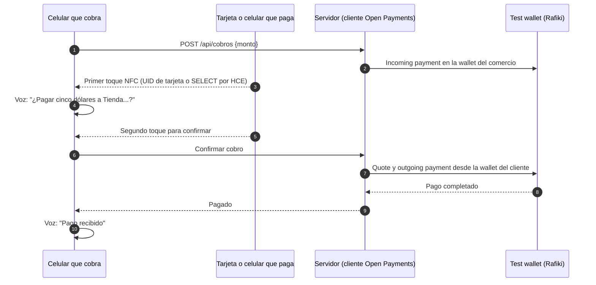
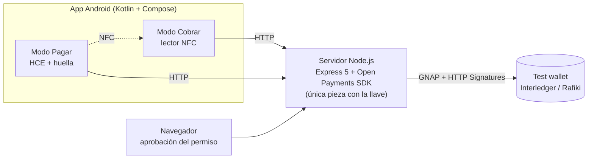

# POS móvil con Open Payments

Pagar y cobrar acercando el celular, con **Open Payments** de Interledger.

**Premio a la Innovación · Hackathon Open Payments de Interledger 2026**

[](https://github.com/dechouriog/pos-open-payments/actions/workflows/ci.yml)


Una sola app Android con dos modos:

- **Cobrar**: el celular se vuelve un datáfono. El comercio marca el monto, el cliente acerca su tarjeta o su celular y el dinero llega a la wallet del comercio.
- **Pagar**: el celular funciona como una tarjeta sin contacto (NFC con Host Card Emulation), con autorización previa por huella o bloqueo de pantalla.

Los pagos se hacen de verdad contra el **test wallet de Interledger**, con montos, monedas y permisos reales del protocolo.

<!--
Capturas: guarda las imágenes en docs/capturas/ y descomenta este bloque.
<p align="center">
  
  
  
</p>
Video: [Ver demo de 2 minutos](https://youtu.be/...)
-->

## Cómo funciona un cobro



Cada cobro sigue el flujo oficial de Open Payments: **incoming payment** en la wallet de quien recibe, **quote** y **outgoing payment** en la wallet de quien paga.

## Arquitectura



## Decisiones de diseño

- **La llave nunca sale del servidor.** El servidor Node.js es el único cliente de Open Payments: firma cada petición con la llave Ed25519 y guarda los tokens. El celular no tiene credenciales.
- **Un permiso semanal con tope, no uno por pago.** El dueño de la wallet aprueba una sola vez un grant interactivo (GNAP) con `debitAmount` e intervalo `P1W`. Cada cobro reutiliza ese permiso, como en las guías oficiales de pagos recurrentes.
- **Rotación de tokens.** El token del permiso vence a los pocos minutos. El servidor lo rota solo cuando recibe `401` o `403 Inactive Token`.
- **Dinero en enteros.** Los montos se manejan como enteros (`BigInt` en el servidor, `Long` en la app) y la moneda se lee de la wallet (`assetCode`, `assetScale`), nunca está fija.
- **Doble toque para confirmar.** El primer toque identifica a quien paga y la voz anuncia el monto; el segundo lo confirma. Si el segundo toque viene de otro medio, el cobro se rechaza (`TARJETA_DISTINTA`).
- **HCE solo cuando corresponde.** El celular responde como tarjeta únicamente en modo Pagar y con autorización vigente (60 s tras la huella). Usa un AID propietario (`F0 44 41 54 41 46 4F 4E 4F`, "DATAFONO") con `requireDeviceUnlock` para no chocar con Google Wallet ni con el servicio NDEF de Android.

## Funcionalidades

| Modo Cobrar | Modo Pagar |
|---|---|
| Teclado de monto y voz que anuncia cada paso | Saldo disponible de la semana, tope y fecha de renovación |
| Cobro con tarjetas NFC o con otro celular | Aprobación del permiso semanal desde el navegador |
| Registro de tarjetas nuevas | Autorización con huella o PIN antes de pagar |
| Historial de cobros con totales del día | Gestión de tarjetas: renombrar, bloquear, eliminar |

Errores que maneja el sistema: `SIN_PERMISO`, `TOPE_SUPERADO`, `COBRO_VENCIDO`, `TARJETA_DISTINTA`, `MEDIO_BLOQUEADO`, `MISMA_CUENTA`, `TIEMPO_AGOTADO`, `PAGO_FALLIDO`, entre otros.

## Stack

| Capa | Tecnologías |
|---|---|
| App | Kotlin, Jetpack Compose, Material 3, NFC (reader mode + Host Card Emulation), BiometricPrompt, TextToSpeech |
| Servidor | Node.js, Express 5, `@interledger/open-payments` |
| Protocolo | Open Payments, GNAP, HTTP Message Signatures, Interledger test wallet (Rafiki) |
| Pruebas | JUnit (app), `node:test` (servidor), GitHub Actions |

## Estructura

```
.
├── app/                    App Android (un solo módulo)
│   └── src/main/java/…     MainActivity, ModoCobrar, ModoPagar, PagoHceService, ServidorApi…
├── servidor/               Cliente de Open Payments
│   ├── servidor.mjs        Rutas de cuentas, cobros, historial y aprobación de permisos
│   ├── billetera.mjs       Rutas del celular en modo Pagar
│   ├── permisos.mjs        Grant interactivo con tope semanal
│   ├── op.mjs              SDK de Open Payments con log por etapas y rotación de tokens
│   └── *.test.mjs          Pruebas
└── docs/                   Guía de pruebas
```

## Cómo correrlo

**Requisitos:** Android Studio, un celular Android con NFC (y bloqueo de pantalla para el modo Pagar), Node.js 20.12 o superior y cuentas en el [test wallet de Interledger](https://wallet.interledger-test.dev).

**1. Credenciales del test wallet**

1. Crea una wallet address para la app (el cliente de Open Payments).
2. En la configuración de desarrollador, genera un par de llaves. Guarda la llave privada como `private.key` en la raíz del proyecto y copia el **Key ID**.
3. Crea al menos dos wallets más: una para el comercio y otra para el cliente.

**2. Servidor**

```bash
cd servidor
cp .env.example .env     # completa APP_WALLET_ADDRESS, KEY_ID y las wallets de prueba
npm install
npm run probar           # crea un incoming payment y un quote; no mueve dinero
npm start                # http://localhost:3000
```

**3. App**

1. Abre el proyecto en Android Studio.
2. Conecta el celular por USB y redirige el puerto para que la app llegue al servidor:
   ```bash
   adb reverse tcp:3000 tcp:3000
   ```
3. Ejecuta la app, crea tu cuenta con tu wallet address y elige **Cobrar** o **Pagar**.

La guía completa con casos de prueba está en [docs/guia-de-pruebas.md](docs/guia-de-pruebas.md).

## Pruebas

```bash
cd servidor && npm test        # 19 pruebas: montos, medios, cuentas, historial, permisos
./gradlew :app:testDebugUnitTest   # 34 pruebas: montos, NDEF, protocolo HCE, ventas, voz
```

## Lo que aprendí

- El test wallet responde **403 "Inactive Token"**, no 401, cuando vence el token del permiso. Sin manejar ese caso, la rotación nunca se dispara.
- Solo el dueño de la wallet puede aprobar un grant. Si el navegador tiene abierta otra sesión, el test wallet rechaza el permiso automáticamente y el enlace ya no sirve.
- Un grant que termina con redirect no se puede consultar por polling: sin `interact_ref` no hay token.
- Rafiki filtra los outgoing payments por cliente aunque el token tenga `list-all`, así que el historial solo muestra los pagos hechos desde esta app.
- La autorización biométrica no cabe dentro de un toque NFC (dura milisegundos). Por eso se autoriza antes y queda una ventana de 60 s.
- Android 16 trae un servicio que responde al AID estándar de NDEF; un AID propietario evita ese choque.
- `HttpURLConnection` no soporta `PATCH`: la app envía `POST` con `X-HTTP-Method-Override`.

## Estado y limitaciones

Es un prototipo construido para la hackathon:

- El celular llega al servidor por USB con `adb reverse` y HTTP local. En producción el servidor estaría en la nube con HTTPS.
- Los datos se guardan en un archivo JSON. En producción irían en una base de datos.
- Funciona contra el test wallet de Interledger, no con dinero real.

## Autor

**Diego Chourio Garcia** · Estudiante de Ingeniería de Sistemas, Universidad EAFIT · [LinkedIn](https://www.linkedin.com/in/diego-eduardo-chourio-garcia-472291385/)

Licencia [MIT](LICENSE).
